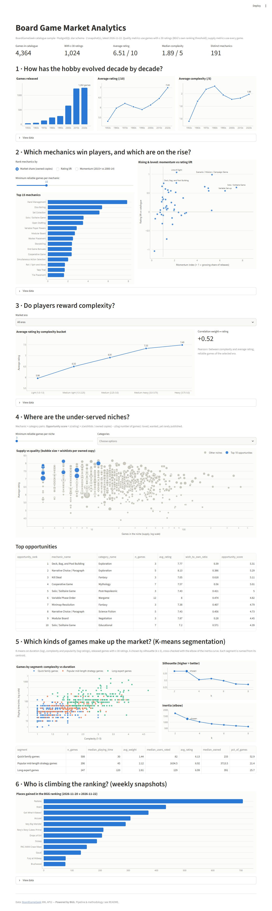
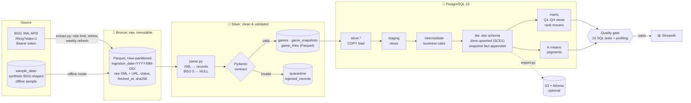
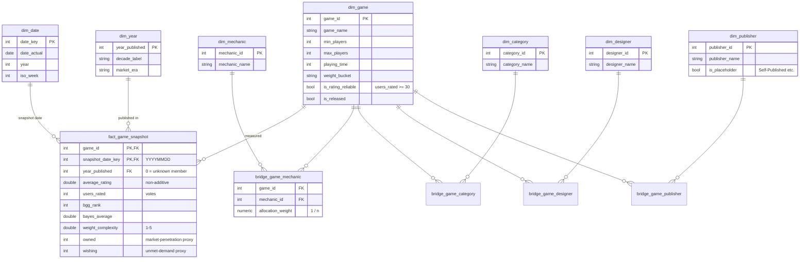

# 🎲 Where are the niches in the board game market?

**Which kinds of games are highly rated by players, yet still rarely published?**

This project answers that question for a board game publisher. It runs an end-to-end
analytics pipeline on the BoardGameGeek (BGG) catalogue: API extraction, a dimensional
model in PostgreSQL, weekly history, advanced SQL, K-means segmentation and a dashboard.

> **V2 of [boardgame_analysis](https://github.com/tsauffisseau/boardgame_analysis).** V1
> was exploratory notebooks on a static Kaggle export, limited to duration, complexity
> and popularity: UMAP map, Ridge model of under/over-rated games, similarity-based
> recommendations. V2 delivers the roadmap V1 announced: mechanics and themes, niches,
> an interactive dashboard. It also industrialises the work: live API ingestion, a
> tested star schema, weekly history and a one-command Docker deployment.

[](https://github.com/tsauffisseau/ludique/actions/workflows/ci.yml)


```
BGG XML API ──► Bronze (raw XML) ──► Silver (validated) ──► PostgreSQL star schema ──► SQL marts ─┬─► Streamlit
                 Parquet, immutable    Pydantic contracts     facts · dims · bridges      + K-means  └─► S3 / Athena (optional)
                                                              weekly incremental history
```

---

## 1. Key findings

*On real BGG data: a uniform random sample of 15,000 BGG ids yielding 4,364 board games
(1,024 with at least 30 ratings), with two snapshots taken on 2026-11-20 and 2026-11-22.*

1. **The white space is story-driven, solo-capable adventure.** Among mechanic × theme
   niches with at least 5 established games, the best opportunity scores go to
   *Scenario/Campaign × Exploration* (average rating **8.11**, only 10 games in the sample),
   *Solo × Civilization*, *Solo × Exploration* and *Campaign × Adventure*: top ratings, a
   high wishlist-to-owned ratio and little supply.
2. **Solo play is the growth mechanic, and roll-and-move is dying.** *Solo / Solitaire*
   went from **1.3 %** of 2000–2014 releases to **9.5 %** of 2015+ releases (momentum
   **×7.5**), with a **+0.65** rating lift over the catalogue. *Roll / Spin and Move* fell to
   a quarter of its former share (**×0.24**) and is the worst-rated mechanic (**−1.04**).
3. **Complexity buys ratings, not reach.** Complexity and rating are clearly correlated
   (**r = 0.52**: light games average 5.96, heavy games 7.49), while ownership barely
   follows (r = 0.23 with log-owned copies).
4. **The market is concentrated in one segment.** K-means finds 3 segments. *Popular
   mid-length strategy games* are **21 %** of established games but hold **83 %** of all
   owned copies, against 9 % for *Quick family games* (53 % of titles) and 8 % for *Long
   expert games*.

Also visible in the data: the hobby grew by volume, not by weight. 62 % of the games with
a known year were published in 2010 or later, yet average complexity has stayed around
1.9–2.1 / 5 since the 1970s.

> **About the data in this repository.** The BGG XML API licence is non-commercial and
> does not cover redistributing its data. The repository therefore ships a **synthetic,
> BGG-shaped sample** (invented games, same XML format, built by
> [`scripts/generate_synthetic_sample.py`](scripts/generate_synthetic_sample.py)), so the
> whole pipeline runs offline. The findings above and the screenshot below come from real
> API data that is kept locally and not committed. With your own BGG token, one command
> reproduces them (see [§ 6](#6-how-to-run)).

<details open>
<summary><b>Dashboard</b> (real data, Streamlit; light theme shown, dark theme follows the OS)</summary>



</details>

---

## 2. Architecture



| Step | What it does | Skill shown |
|---|---|---|
| **Extraction** | Python client on the BGG XML API: list of ids (random catalogue sample, trending games or a file), then details in batches of 20. Throttling, exponential back-off on `429/5xx`, `Retry-After`, and raw responses saved untouched | ETL, robustness, respectful API use |
| **Raw → clean** | XML parsing, typing, BGG `0 = unknown` → `NULL`, one snapshot per game per day, Pydantic contracts with a quarantine table | Data quality |
| **Star schema** | PostgreSQL: `fact_game_snapshot` (rating, votes, rank, complexity, owners…) plus `dim_game`, `dim_mechanic`, `dim_category`, `dim_designer`, `dim_publisher`, `dim_date`, `dim_year` and bridge tables for the N-N links. Primary keys, foreign keys and CHECK constraints | Dimensional modelling |
| **History** | Weekly `refresh` re-snapshots the known catalogue. The fact table is loaded incrementally with a high-watermark and dimensions are upserted, so nothing is fully reloaded | Incremental loading, time series |
| **Analytical SQL** | 6 commented queries + 6 marts: niches, rank evolution with window functions, top games per category with CTEs, `GROUPING SETS`, percentiles | Advanced SQL |
| **Clustering** | K-means on duration, complexity and popularity. k chosen by silhouette and cross-checked with the elbow; each segment named in business language | Data science for the business |
| **Dataviz** | Streamlit dashboard with 6 sections, hover tooltips, a table view per chart and light/dark themes | Restitution |
| **Industrialisation** | `docker compose up`, `.env.example`, 29 pytest tests on a real PostgreSQL, GitHub Actions (lint, tests, pipeline, compose) | Docker, Git, rigour |

---

## 3. Star schema



**Grain:** one row per game per snapshot date. The view `fact_game_latest` exposes the
latest snapshot of each game. Full column definitions and metric formulas are in
[docs/data_dictionary.md](docs/data_dictionary.md).

**PostgreSQL schemas = layers:** `silver` (COPY-loaded landing tables) → `staging` (views)
→ `intermediate` (business rules) → `dw` (star schema) → `marts` (one view per question,
plus the clustering outputs). A short runner ([`load.py`](src/bgg_pipeline/load.py))
infers dependencies between the SQL files, executes them in topological order (like
dbt's `ref()`), and runs the whole build **in a single transaction**, so a failing model
never leaves a half-built warehouse.

---

## 4. History, SQL and segmentation

### Weekly history with incremental loading
`python -m bgg_pipeline refresh` (or `docker compose --profile live run --rm refresh`)
re-fetches the stats of every known game and appends a dated snapshot:

- **Bronze** gets a new `ingestion_date=` partition, and nothing is overwritten.
- **Dimensions** are *upserted* (SCD type 1): new games are inserted, and changed names
  or attributes are updated.
- **Fact:** only snapshots on or after the *high-watermark* (latest date already loaded)
  are processed. `ON CONFLICT … DO UPDATE … WHERE … IS DISTINCT FROM` makes re-runs
  idempotent without rewriting unchanged rows, so `loaded_at` stays a truthful audit trail.

Tested end to end: the second load of the real data added 4,364 rows (8,728 in history),
left the existing history untouched, and a third run with nothing new changed nothing.
It can be scheduled with cron or Windows Task Scheduler, or as a single Airflow task.

### Analytical SQL ([`sql/analysis/`](sql/analysis), run with `make analysis`)
| # | Business question | Techniques |
|---|---|---|
| 01 | Which mechanics are well rated yet rare? | CTE benchmark, `FILTER`, `PERCENT_RANK()` |
| 02 | Which games are climbing the ranking? | `LAG`, `FIRST_VALUE`, named `WINDOW`, `ROW_NUMBER` |
| 03 | Top 3 games per category | chained CTEs, `ROW_NUMBER() OVER (PARTITION BY …)`, Bayesian average |
| 04 | Publisher leaderboard | bridge allocation weights, `DENSE_RANK`, conditional aggregation |
| 05 | When did solo and co-op take off? | `BOOL_OR`, running totals `SUM() OVER (ORDER BY …)` |
| 06 | Which themes characterise each segment? | ML output joined to the star schema, window shares, lift |

The marts add `GROUPING SETS` (complexity × era), `PERCENTILE_CONT`, `CORR`, z-scores
clipped with `GREATEST/LEAST`, and `DISTINCT ON` for the latest snapshot.

### Segmentation ([`clustering.py`](src/bgg_pipeline/clustering.py))
K-means on **duration** (log), **complexity** and **popularity** (log of ratings), using
released games with at least 30 ratings, standardised. k is chosen as the best
**silhouette** for k ≥ 3 and cross-checked against the **elbow** of the inertia curve.
k = 2 only splits "light" from "heavy", which is not actionable. Each segment is then
named from its centroid:

| Segment (real data) | Share of games | Median duration | Avg complexity | Median owned | Share of owned copies |
|---|---:|---:|---:|---:|---:|
| Quick family games | 53 % | 30 min | 1.44 | 233 | 9 % |
| Popular mid-length strategy games | 21 % | 45 min | 2.12 | 3,714 | **83 %** |
| Long expert games | 26 % | 120 min | 2.81 | 391 | 8 % |

The chosen k = 3 has a silhouette of 0.366. The elbow suggests k = 4, which splits the
strategy games further; k = 3 is kept for readability.

---

## 5. Data quality and design decisions

**Three levels of control.** The pipeline **stops** if a blocking check fails.
1. **Contract (Silver, Pydantic):** types and ranges (rating 1–10, complexity 1–5).
   Invalid records go to a quarantine table together with the reason.
2. **Profiling (Silver):** completeness per column, plus soft anomalies such as
   `min_players > max_players`, games longer than 24 h or announced for a future year.
3. **SQL data tests (Gold, [`sql/tests/`](sql/tests)):** tables not empty, unique keys,
   declared fact grain, referential integrity, ranges, and bridge weights summing to 1.
   These come on top of the native PK/FK/CHECK constraints.

Severity `error` blocks the pipeline. Severity `warn` is reported with example rows: a
100-hour wargame is real, so it is flagged, not "fixed". Real-data report:
[docs/results/data_quality_report_real_data.md](docs/results/data_quality_report_real_data.md).

**Design decisions and trade-offs**
- **PostgreSQL** gives native constraints, `ON CONFLICT` upserts for incremental loading,
  and rich SQL (window functions, `GROUPING SETS`, `DISTINCT ON`). Parquet stays the
  exchange format, so the same lake can be read by Athena or Spark. *Trade-off:* this
  is a single node; at scale, Gold would move to dbt on Snowflake or BigQuery.
- **Bridge tables with `allocation_weight = 1/n`.** A game has several mechanics, so a
  plain bridge double counts additive measures such as owned copies. Averages use the
  plain bridge and totals use the weighted one, and a test checks that the weights sum to 1.
- **Kimball "unknown member".** The 7.6 % of games without a publication year point to
  `dim_year = 0`. A NULL foreign key would make them disappear from inner joins.
- **"0 means unknown."** BGG writes `0` for a missing year, complexity or average. Left
  as-is, these zeros drag every average down, so they become `NULL` in Silver, with
  unit tests.
- **Uniform random sample of ids, not a "Top 1000".** A top list only shows winners
  (survivorship bias). Because BGG ids are sequential, a uniform draw is an unbiased
  sample of the catalogue, which makes the supply counts of the niche score meaningful.
  Quality metrics use games with at least 30 ratings, BGG's own ranking threshold.
- **Robustness found by inspecting the data.** A first niche score was dominated by a
  2027 crowdfunding title with 763 wishlists for 5 owned copies. Unreleased games are
  now excluded, the demand signal is log-scaled and z-scores are clipped at ±3. Momentum
  is `NULL` when the reference base has fewer than 5 games, instead of a "×25" computed
  from one game.
- **Proxies.** BGG publishes no sales figures. `owned` stands in for market penetration
  and `wishing` for unmet demand.

---

## 6. How to run

**Everything in Docker (recommended):**
```bash
git clone https://github.com/tsauffisseau/ludique.git && cd ludique
docker compose up --build        # PostgreSQL + pipeline + dashboard → http://localhost:8501
```
The pipeline container loads the synthetic sample, builds the warehouse, runs the
segmentation and the quality gate, then the dashboard starts. PostgreSQL is published on
`localhost:55432` (configurable with `BGG_PG_HOST_PORT`), which avoids conflicts with a
local install. The SQL queries run with `docker compose run --rm pipeline python -m bgg_pipeline analysis`,
and `docker compose cp pipeline:/app/reports ./reports` retrieves the data-quality report.

**Local Python** (PostgreSQL from compose):
```bash
make install && make db          # dependencies + PostgreSQL only
make run-pipeline                # Bronze → Silver → Gold → segments → quality gate
make analysis                    # the 6 commented SQL queries
make dashboard                   # http://localhost:8501
make test                        # 29 tests (unit + end-to-end on PostgreSQL)
```
Without `make` (Windows): `pip install -r requirements.txt && pip install -e .` then
`python -m bgg_pipeline run`.

**Real data from the BGG API.** Register an application at
<https://boardgamegeek.com/applications>, copy `.env.example` to `.env`, set `BGG_API_TOKEN`:
```bash
python -m bgg_pipeline run --source api --random 15000   # catalogue sample (~40 min, rate-limited)
python -m bgg_pipeline refresh                           # every week: new dated snapshot
python -m bgg_pipeline run --source api --hot            # or: today's 50 trending games
```

**S3 + Athena (optional).** `pip install boto3`, set `BGG_S3_BUCKET` and AWS credentials,
then run `python -m bgg_pipeline export --s3`. This uploads Bronze, Silver and Gold as
Parquet, with one folder per table. [`sql/athena/`](sql/athena) contains the DDL
(external tables, Hive partitions) and example queries.

---

## 7. Project structure

```
├── src/bgg_pipeline/
│   ├── extract.py        # Bronze: rate-limited API client, raw Parquet writer
│   ├── parse.py          # XML → records (pure functions, "0 means unknown")
│   ├── schemas.py        # Pydantic data contracts
│   ├── transform.py      # Silver: snapshots, dedup, validation, quarantine
│   ├── load.py           # Gold: COPY into PostgreSQL + SQL DAG runner (one transaction)
│   ├── clustering.py     # K-means segmentation (silhouette + elbow, business naming)
│   ├── data_quality.py   # profiling + SQL tests + report
│   ├── export.py         # Parquet lake + optional S3 upload
│   └── __main__.py       # CLI: run | refresh | extract | transform | build | segment | quality | analysis | export
├── sql/
│   ├── silver/           # landing tables DDL
│   ├── staging/          # stg_*  views
│   ├── intermediate/     # int_*  business rules (buckets, reliability, allocation weights)
│   ├── marts/core/       # star schema: dim_*, bridge_*, fact_game_snapshot (+ latest view)
│   ├── marts/analytics/  # mart_* : one view per business question
│   ├── analysis/         # 6 commented analytical queries
│   ├── tests/            # SQL data tests (error | warn)
│   └── athena/           # Athena DDL + example queries
├── dashboard/app.py      # Streamlit
├── tests/                # pytest: parsing, client retries, Silver, warehouse, incremental, clustering, dashboard
├── sample_data/          # synthetic BGG-shaped Bronze sample (4 weekly snapshots)
├── scripts/              # synthetic sample generator, real sample builder
├── docs/                 # data dictionary, screenshot, real-data quality report
├── docker-compose.yml · Dockerfile · Makefile · .env.example
└── .github/workflows/ci.yml
```

---

## 8. Limits and next steps

- **Short history so far.** The real data has two snapshots, two days apart. The weekly
  refresh makes trends meaningful after a few months. Next step: SCD type 2 on
  `dim_game` to track changes in attributes as well as in metrics.
- **Proxies, not sales.** `owned` and `wishing` are community signals, biased toward the
  BGG audience (enthusiast, English-speaking). Joining distributor sell-out data would
  turn the opportunity score into a revenue estimate.
- **Sample size.** The 15,000 random ids yield about 1,000 established games, enough for
  mechanics and themes but thin for some niches (≥ 5 games enforced). The same code can
  ingest the full catalogue.
- **Orchestration and scale.** Each step is an idempotent CLI command that maps one to one
  onto Airflow tasks or Dagster assets. Gold could move to dbt, and Bronze/Silver to S3
  (export already in place).

---

**Powered by BGG.** Data comes from the [BoardGameGeek](https://boardgamegeek.com) XML API2
and is used under its [terms of use](https://boardgamegeek.com/xmlapi/termsofuse) for a
non-commercial portfolio project. BGG data is not redistributed in this repository, and
the sample in `sample_data/` is synthetic.

Author: **Théophile Sauffisseau**, engineer (Télécom SudParis), Data Consultant / Product Data Analyst.
